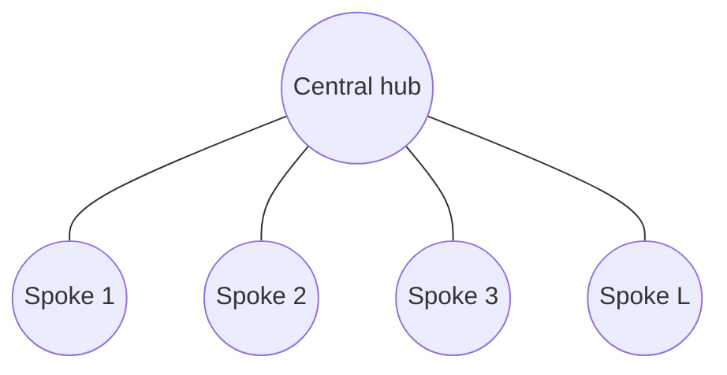
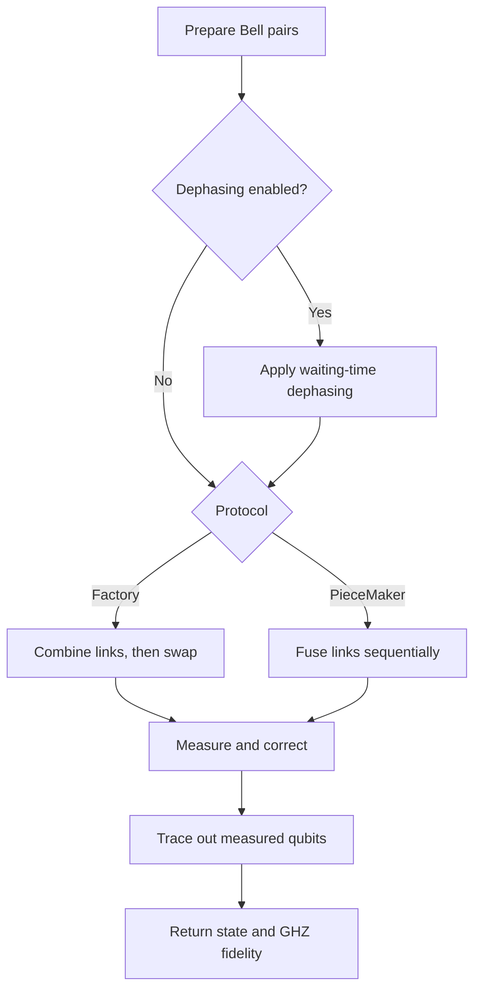

# StarProtocol

`qrnetwork/StarProtocol.py` simulates entanglement swapping in a star network. A central hub connects to `link` outer nodes; each connection starts as a Bell pair.

## Diagrams

**Star topology**



**Protocol flow**



## Methods

- **`StarProtocol.factory(...)`** — prepares all Bell pairs, applies waiting-time dephasing if enabled, then performs swapping.
- **`StarProtocol.piecemaker(...)`** — fuses links sequentially and applies dephasing to stored qubits during waiting gaps.

Both methods return `(rho, fidelity_string)`, where `rho` is the final reduced density matrix and the fidelity string has the form `fidelity = 0.999999999999999`. Measurements are sampled, so each call follows one measurement trajectory rather than averaging over outcomes.

## Usage

```python
from qrnetwork.StarProtocol import StarProtocol

rho, fidelity = StarProtocol.factory(link=3, noise=False)
rho, fidelity = StarProtocol.piecemaker(link=3, noise=False)

# Enable dephasing
rho, fidelity = StarProtocol.factory(
    link=3, noise=True, Lambda=0.98, rounds=[0, 1, 3]
)
rho, fidelity = StarProtocol.piecemaker(
    link=3, noise=True, Lambda=0.98, rounds=[0, 1, 3]
)
```

`Lambda=0.98` is an example value; select parameters and arrival rounds for the physical model.

## Parameters

```python
StarProtocol.factory(link, noise=False, Lambda=None, rounds=None, verbose=False)
StarProtocol.piecemaker(link, noise=False, Lambda=None, rounds=None, verbose=False)
```

- `link`: number of Bell-pair links.
- `noise`: enables waiting-time dephasing.
- `Lambda`: dephasing parameter; required when `noise=True`.
- `rounds`: link arrival rounds. If omitted, Factory uses all-zero rounds, so no waiting-induced dephasing occurs.
- `verbose`: enables diagnostic output.

## Protocol steps

### Factory

1. Create `link` Bell-pair density matrices.
2. If noise is enabled, calculate each link's wait for the last link and apply dephasing.
3. Tensor-product the links into one state.
4. Apply entangling gates, measure spoke ancillas, and apply conditional `X` corrections.
5. Apply a Hadamard to the hub qubit, measure it, and apply a conditional `Z` correction.
6. Trace out measured/ancillary qubits and calculate GHZ fidelity.

### PieceMaker

1. Create Bell-pair states and order their arrival rounds when noise is enabled.
2. Initialize the state with the first link; append and fuse each subsequent link using SWAP/CNOT operations.
3. Measure each fusion ancilla, apply a conditional `X` correction, and remove the measured qubit.
4. If noise is enabled, dephase the stored hub qubit during inter-arrival waits.
5. Apply the final Hadamard and measurement, apply a conditional `Z` correction, and remove the measured qubit.
6. Calculate output fidelity.

**Limitation:** The current noise-enabled PieceMaker path accesses `rounds[1]` and therefore expects at least two links. For a single link, use `noise=False` or add explicit single-link handling.

## Noise model

The protocol models pure dephasing with Kraus operators

\[
K_0=\sqrt{\frac{1+\Lambda}{2}}I,\qquad
K_1=\sqrt{\frac{1-\Lambda}{2}}Z.
\]

Each application preserves populations and scales off-diagonal coherence by `Lambda`; after `steps` applications, the factor is `Lambda**steps`.

- `dephase_state_2qubit(rho_2qubit, Lambda, steps)`: dephases a two-qubit Bell link.
- `dephase_hub_qubit(rho, n_qubits, hub_idx, Lambda, steps)`: dephases a selected qubit in a composite state.

Factory dephases links while waiting for the last arrival. PieceMaker dephases the stored state during arrival gaps. This model does **not** include photon loss, amplitude damping, dark counts, or imperfect gates.

## GHZ fidelity

`ghz_fidelity(rho)` computes overlap with the positive-phase GHZ target:

$$
|\mathrm{GHZ}_N\rangle = \frac{|0\rangle^{\otimes N} + |1\rangle^{\otimes N}}{\sqrt{2}},
\qquad
F = \langle \mathrm{GHZ}_N | \rho | \mathrm{GHZ}_N \rangle.
$$

Fidelity `1` indicates a match under the assumed qubit ordering and phase convention. Different ordering or local phase conventions can lower the reported value.

## Implementation notes

- Qubit ordering and indices matter for gates, measurements, corrections, and partial traces.
- Measurement outcomes use `np.random.choice`; set `np.random.seed(...)` for repeatable debugging in the same environment.
- Quantum helpers are imported from `.primaryfn`: `Q`, `Qp`, and `fold`. The initial register contains `2 * link` qubits.
