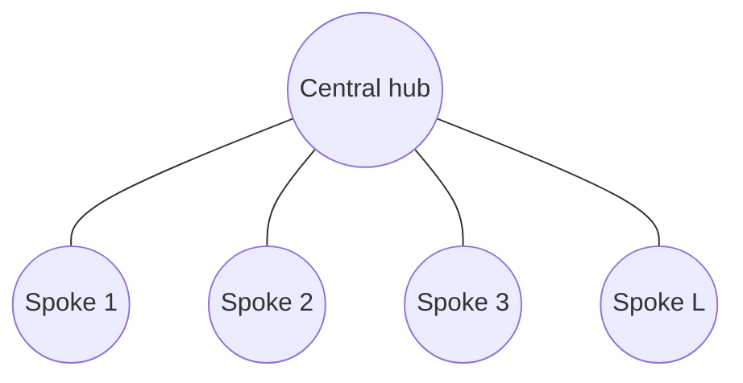
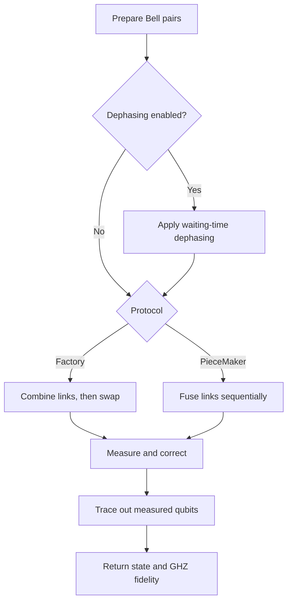

<!-- ---
title: "Quantum Repeater Network"
permalink: /
layout: default
--- -->
<!-- Above is front matter -->

# QNeCT — Quantum Network and Communication Toolbox

An open-source Python toolbox for simulating **quantum repeater networks** (linear chains and star networks) and for analysing small quantum systems.


## Table of Contents
1. [About](#about)
2. [Package Overview](#package-overview)
3. [Getting Started](#getting-started)
    - [Prerequisites](#prerequisites)
    - [Installation](#installation)
    - [Quick Start](#quick-start)
4. [Functions Overview](#functions-overview)
    - [Fundamental operations on quantum systems](#fundamental-operations-on-quantum-systems)
    - [Entanglement Criterion](#entanglement-criterion)
    - [Quantum Network: analytical linear chain](#quantum-network-analytical-linear-chain)
    - [Linear chain: discrete-event noisy simulation](#linear-chain-discrete-event-noisy-simulation)
    - [Star network](#star-network)
    - [Unified simulator](#unified-simulator)
    - [Graphical interface](#graphical-interface)
5. [Contributing](#contributing)
6. [License](#license)
7. [Contact](#contact)
8. [Acknowledgements](#acknowledgements)

## About

**QNeCT** is an open-source software library designed primarily for simulating **quantum repeater–based networks**. In addition, it provides tools to model and analyze **complex quantum mechanical systems**. It is built upon well-established Python packages such as [**NumPy**](https://numpy.org/), [**SciPy**](https://scipy.org/), and [**SymPy**](https://www.sympy.org/en/index.html). QNeCT offers a flexible and extensible framework for research and experimentation. It is freely available for use and modification on all major platforms, including **Linux**, **macOS**, and **Windows**.

**Key Features:**
* Solve complex quantum mechanical problems with ease.
* Analyze the performance of quantum channels.
* Evaluate the nature and quality of entanglement distributed over quantum repeater–based networks.
* Simulate linear repeater chains: a fast **analytical** chain (ideal or noisy) and a **discrete-event** (entanglement generation is dicrete, not necessarily all links generate entanglement at same time) simulator with probabilistic sources, memories and three swapping policies (*ASAP*, *Last*, *Nesting*).
* Simulate **star networks** that distribute multipartite GHZ states (*PieceMaker* and *Factory* protocols).
* Run everything from one entry point (`QNeCTSimulator`) or from the **Streamlit** graphical interface.

## Package Overview

All modules live in the `qrnetwork` package.

| Module | Contents | Purpose |
|--|--|--|
| `primaryfn.py` | `Q`, `Qp`, `Is`, `Ebit`, `fold` | Quantum states/operators, tensor products, fidelity, entanglement check |
| `qteleportation.py`, `qchannel.py` | `Teleport`, `QChannel` | Teleportation and average teleportation fidelity of a channel |
| `network.py` | `eswap`, `QRep`, chain topology classes (`SlotStatus`, `MemorySlot`, `Link`, `Node`, `RepeaterChain`) | Entanglement swapping, analytical repeater chain, linear-chain topology |
| `ent_manager.py` | `EntGenSource`, `RepSwap`, `Noise` | Entanglement generation, swapping, memory dephasing, dark counts and imperfect BSM |
| `linear_noisy_sim.py` | `SimulationConfig`, `RepeaterSimulation`, `Scheduler`, `EventQueue`, `SimulationResult` | Discrete-event simulation of a noisy linear chain |
| `star_protocol.py` | `StarProtocol` | Star-network GHZ distribution (`piecemaker`, `factory`) |
| `simulator.py` | `QNeCTSimulator`, `StarConfig`, `UnifiedResult` | One entry point for linear (discrete-event) and star simulations, repeated runs, sweeps and comparisons |

Top-level scripts: `app.py` (Streamlit GUI), `lin_noisy_net_example.py` (discrete-event example), `unified_example.py` (unified simulator example), `mainQRN.py` (analytical-chain examples).

**Which tool for which problem?**

| Topology | Protocol / policy | Tool |
|--|--|--|
| Linear | Ideal or noisy Bell-pair swapping, all links generated simultaneously | `QRep` |
| Linear | `asap`, `last`, `nesting` with probabilistic generation, memories, timing | `RepeaterSimulation` |
| Star | `piecemaker`, `factory` | `StarProtocol` |
| Any of the above, repeated / compared / swept | | `QNeCTSimulator` or the GUI |

## Getting Started

### Prerequisites
You must have a pre-installed Python environment such as [**Anaconda**](https://www.anaconda.com/download) and an editor such as [**VS Code**](https://code.visualstudio.com/download) to use the **QNeCT** package. The code has been tested with Python 3.12.

### Installation

1.  Clone the repository
    ```sh
    git clone https://github.com/QNeCT-India/Quantum_Repeater_Network.git
    ```
2.  Navigate to the project directory
    ```sh
    cd Quantum_Repeater_Network
    ```
3.  Install the required packages (NumPy, SciPy, SymPy, pandas, Streamlit)
    ```sh
    pip install -r requirements.txt
    ```
4.  (Optional) Start the graphical interface
    ```sh
    streamlit run app.py
    ```

Run scripts and Streamlit from the project folder so that the `qrnetwork` package can be imported.

### Quick Start

```python
from qrnetwork import Q, Qp, QRep, SimulationConfig, StarConfig, QNeCTSimulator

# 1) Ideal swapping over 3 links (two repeaters)
result = QRep([Q.Bell.phi_plus] * 3).linear()
print(result[0]["fidelity"])                       # 1.0

# 2) Noisy analytical chain (density matrices are required)
rho = Qp(Q.Bell.phi_plus).op()
result = QRep([rho] * 4).noise(L=25, T_p=1e-6, T_dp=1e-2, eta=0.9, p_d=1e-6, loss=0.2).linear()

# 3) Discrete-event simulation and star network through one interface
sim = QNeCTSimulator()
res = sim.run(SimulationConfig(rep_nodes=3, rep_spacing_km=30, swap_policy="nesting", seed=1), runs=10)
print(res.fidelity_mean, res.rate_mean)
res = sim.run(StarConfig(n_links=3, protocol="factory", noise=True, Lambda=0.98, rounds=(0, 1, 3)), runs=10)
print(res.fidelity_mean)
```

## Functions Overview

Comprehensive instructions are provided below to assist users in utilizing the existing functions of **QNeCT**.

### Fundamental operations on quantum systems
Quantum states are represented either by a complex wave function or a complex column vector. All fundamental mathematical tools/operations used to deal with quantum mechanical systems are embedded in the **Q** class. The functions and their usage under the class **Q** are listed in the table below. This class also contains the well-known quantum states (Bell states) and operations (Pauli operations, common gates). Tensor products and fidelities are handled by the companion class **Qp**.

| Functions | Usage |
|--|--|
| `Q(input).d()` | Gives dagger of an input matrix array. |
| `Q(input).n()` | Gives norm of an input matrix array. |
| `Q(input).u()` | Gives normalized state of an input matrix array. |
| `Q(input).dm()` | Gives density matrix if input array is a ket vector. |
| `Q(input).purity()` | Gives purity as 1 if an input matrix array is a ket vector and calculates `tr(input^2)` if input array is a square matrix. |
| `Q(input).tr()` | Gives trace of an input matrix array. |
| `Q(input).ptr([indices of qubits])` | Gives partial trace of an input matrix array, tracing out qubits at specified indices. |
| `Q(input).expand_mixed([kept positions], N)` | Expands input state to N-qubit state, adding maximally mixed state (I/2) at vacant positions. |
| `Q.rand.haar(n)` | Gives a random Haar unitary matrix of size n × n. |
| `Q.rand.p(n)` | Gives a random n-qubit pure state. |
| `Q.rand.m(n)` | Gives a random n-qubit mixed state. |
| `Q.Bell.phi_plus / phi_minus / psi_plus / psi_minus` | Gives one of the four Bell states. |
| `Q.Bell.all()` | Gives all the four Bell states. |
| `Q.Werner(p)` | Gives the Werner state built from the Bell state `phi_plus` and the maximally mixed state: p times the Bell-state projector plus (1 − p) times I/4 (random `p` in [1/2, 1] if omitted). |
| `Q.Pauli.I / X / Y / Z` | Gives one of the Pauli matrices. |
| `Q.Pauli.all()` | Gives all the Pauli matrices. |
| `Q.basis(dim, index)` | Generates the computational-basis state with the specified index in a Hilbert space of dimension `dim`. For example, `Q.basis(2, 0)` generates the first basis state and `Q.basis(2, 1)` the second. |
| `Q.Cops.Cg(gate, n_qubits, control, target)` | Constructs a controlled single-qubit gate on an `n_qubits` register, applying `gate` to `target` when the `control` qubit is in state 1. |
| `Q.Cops.Cx(n_qubits, control, target)` | Constructs a controlled-X (CNOT) operation with the specified control and target qubits. |
| `Q.Cops.Cy(n_qubits, control, target)` | Constructs a controlled-Y operation with the specified control and target qubits. |
| `Q.Cops.Cz(n_qubits, control, target)` | Constructs a controlled-Z operation with the specified control and target qubits. |
| `Q.SWAP(n_qubits, qubit1, qubit2)` | Constructs an operator that swaps the states of `qubit1` and `qubit2` in an `n_qubits` register. |
| `Q.Gate.H / S / T` | Gives the Hadamard, S phase and T phase gates. |
| `Q.Gate.CNOT` | Gives the controlled-NOT gate. |
| `Qp(states).tp()` | Computes the tensor product of the states/operators supplied to `Qp`; for example, `Qp(state1, state2).tp()`. |
| `Qp(state1, state2).ip()` | Inner product of two kets, or `Tr(A†B)` of two matrices. |
| `Qp(ket1, ket2).op()` | Outer product of two kets (ket1 times the dagger of ket2); with one argument, `Qp(ket).op()` gives the density matrix of `ket`. |
| `Qp(state1, state2).fid()` | Fidelity of two states (ket–ket, ket–matrix or matrix–matrix). For anything involving a density matrix this is the *root* (Uhlmann) fidelity, i.e. the square root of the overlap of ρ with the pure target. |
| `Is(state).ket() / .square() / .herm() / .pure()` | Checks whether an array is a column vector, square, Hermitian, or pure. |
| `fold(operation, objects)` | Repeatedly applies a binary operation across the list or tuple of objects, reducing them to one result; for example, `fold(np.kron, [A, B, C])` computes their tensor product. |

`Q` objects support `+`, `-`, `@`, scalar `*` and `/`, and can be passed directly to NumPy functions.

**Other tools**

| Functions | Usage |
|--|--|
| `Teleport(qS, qC)` | Teleports the state `qS` through the channel state `qC`. |
| `QChannel(channel, iteration).teleport()` | Average teleportation fidelity of a channel over `iteration` trials. |

### Entanglement Criterion
A class named **Ebit** is defined to check the nature of entanglement of a given two-qubit quantum state. If the user does not specify a method, *concurrence* is used; it is currently the only implemented method.

```sh
Ebit(state) / Ebit(state, method='concurrence')
```

> **Inputs**
> - **state**: a two-qubit state (ket vector or density matrix)
> - **method**: entanglement-measure method to use (default and only available option: `'concurrence'`)

> ### Workflow of the Ebit class

> #### If `state` is a two-qubit ket vector:
> Compute:
> - value = abs(coeff(|00>)·coeff(|11>) − coeff(|01>)·coeff(|10>))
>
> Output: **value**

> #### If `state` is a two-qubit density matrix:
> Compute:
> - **value** = concurrence (Wootters formula)
>
> Output: **value** (0 for separable states, > 0 for entangled states)

### Analytical Linear Chain
The major challenge of any quantum communication scheme is the communication distance, owing to the rapid loss of weak quantum signals. To overcome this challenge, a quantum repeater is introduced where intermediate nodes are installed between two communicating parties and some actions are performed at these nodes to directly connect the two parties. In the repeater-based quantum network, quantum repeaters are installed at intermediate nodes and entangled states are distributed. Finally, entanglement swapping is performed at those nodes to entangle the two communicating parties.

We defined a class **QRep** for the quantum repeater network. It takes a list of shared entangled states as input (one two-qubit state per link) and gives the final entangled state formed between the two end nodes with its fidelity value. To make it more realistic, one can also check the output under the physical noises present during the entanglement generation process. The entanglement swap itself is implemented in the class **eswap**, which can also be used on its own: `eswap(state1, state2).ket()` / `.density()` / `.swap()`.

```sh
QRep([shared state]).linear()  /  QRep([shared state]).noise(noise parameters).linear()
```

> **Inputs**
> - **shared state:** a list of shared two-qubit states between intermediate nodes (at least two links)
> - **noise parameters:**
>   - `L`: link length (km)
>   - `T_p`: entanglement preparation time (s); accepted but unused, because all links are assumed to be generated at the same time
>   - `T_dp`: memory dephasing time (s)
>   - `eta`: detection/coupling efficiency (multiplies the fibre transmission)
>   - `p_d`: dark-count probability per detection window
>   - `loss`: fibre loss in dB/km (if omitted, an attenuation length of 22 km is used, about 0.2 dB/km)

> **Output:** a list with one dictionary per Bell-measurement outcome, with the keys `measurement_outcome`, `probability`, `fidelity` and `obtained_entangled_state`. Each state is Pauli-corrected towards |Φ⁺⟩.

> ### Workflow of the QRep class

> #### If all shared states are two-qubit ket vectors and entangled:
> Compute:
> - value = entanglement swapping applied link by link (`eswap(...).ket()`)
>
> Output: **value**

> #### If all shared states are two-qubit density matrices and entangled:
> Compute:
> - value = entanglement swapping applied link by link (`eswap(...).density()`)
>
> Output: **value**

> #### If `.noise(...)` is used (density matrices only):
> For every link:
> 1. **Dark counts** on the received qubit: `α·ρ + (1−α)·tr₂(ρ) ⊗ I/2`, with `α = η_arr(1−p_d)/η_eff`, `η_eff = 1 − (1−η_arr)(1−p_d)²` and arrival probability `η_arr = eta · e^(−L/L_att)`.
> 2. **Memory dephasing** `ρ → (1−λ)ρ + λ ZρZ`, `λ = (1 − e^(−t/T_dp))/2`, for the heralding time of the qubits held at repeaters: `2d/c` for the source-side qubit and `d/c` for the receiving-side qubit (`d = L`, `c = 2×10⁸ m/s`). End nodes hold no memory.
>
> Then swap along the chain with an ideal Bell measurement, averaging over the four outcomes after Pauli correction.
>
> Output: the list described above, with `fidelity = ⟨Φ⁺|ρ|Φ⁺⟩`.

**Notes**
- Loss does not damage the state: links are heralded, so loss only lowers the click probability and therefore the share of dark counts.
- The noisy chain assumes all links are generated at the same time, so there is no waiting-time dephasing. For waiting-time effects (swap-ASAP / swap-last) use `RepeaterSimulation`, or `qrnetwork.paper_chain.noisy_chain(..., wait="asap")`.
- Without `.noise(...)`, `fidelity` comes from `Qp.fid()` (root fidelity for density matrices), whereas the noisy chain reports the squared overlap `⟨Φ⁺|ρ|Φ⁺⟩`. The two coincide only for pure states with fidelity 1.
- Noisy swapping raises an error for ket inputs and for separable links.

### Different SWAP Policies in Linear Chain Network

#### Overview

In the package `qrnetwork`, there are three core modules for this simulator: `ent_manager.py` (Entanglement Management), `network.py` (Network Management) and `linear_noisy_sim.py` (Main Simulator Kernel).
1. `ent_manager.py` manages Entanglement Generation `(EntGenSource)` and Entanglement Swapping `(RepSwap)`, which take care of memory dephasing noise, dark counts and imperfect BSM `(Noise)`.
2. `network.py` manages the linear chain topology `(RepeaterChain)`.
3. `linear_noisy_sim.py` manages scheduling `(Scheduler)` and resolving events `(RepeaterSimulation)`.
4. `EntGenSource`, `RepSwap` and `RepeaterChain` talk with `Scheduler`, which schedules source and swap events.
5. `RepeaterSimulation(config).run()` starts the loop of resolving and scheduling events until the desired links are obtained.
6. `lin_noisy_net_example.py` is an example script for the discrete-event, noisy quantum repeater chain simulation.

#### Example script (`lin_noisy_net_example.py`)
1. **Configuration:** a `SimulationConfig` object (`config`) is created, describing the simulation parameters.
2. **Initialization:** `RepeaterSimulation` is constructed from `config` and `run()` is called, which executes the discrete-event simulation until the requested number of end-to-end entangled pairs has been generated.

```python
from qrnetwork import SimulationConfig, RepeaterSimulation

config = SimulationConfig(
    # Nodes
    rep_nodes=3,                   # 3 repeaters + 2 end nodes -> total qubits = 3*2 + 2 = 8
    rep_spacing_km=30.0,
    # Source
    source_efficiency=1e-8,
    source_state_fidelity=0.99,
    # Laser
    laser_power_avg_mW=0.04,
    laser_rep_rate_MHz=100,
    # Detector
    detector_rep_rate_MHz=25,     # laser rate / N for synchronization
    dark_count_rate_hz=100,
    detection_window_s=8e-9,      # time for which detector is on; takes care of uncertainty in arrival time
    # Memory
    dephasing_param_s=0.01,
    # Imperfect BSM
    bsm_fidelity=0.99,
    # Entanglement swapping policy
    swap_policy="asap",           # asap / nesting / last
    # Seed for reproducibility
    seed=102,
)

result = RepeaterSimulation(config).run()
print(vars(result))
```

#### `SimulationConfig`

*Defined in `linear_noisy_sim.py`: a frozen dataclass holding every physical/statistical parameter of the simulation.* Any of the attributes below can be changed during configuration.

| Category | Attribute | Default | Meaning |
|---|---|---|---|
| `Nodes` | `rep_nodes` | 3 | Number of repeater nodes. |
| | `rep_spacing_km` | 50 | Distance between neighbouring nodes (km). |
| `Fibre` | `attenuation_length_km` | 22 | Fibre attenuation length. |
| | `fibre_speed_km_per_s` | 200 000 | Signal propagation speed in the fibre. |
| `Source` | `source_efficiency` | 1e-8 | Probability of getting one entangled pair per photon pump. |
| | `source_state_fidelity` | 1.0 | Fidelity with which the source produces a Werner state. |
| `Laser` | `laser_pulsed` | True | True for a pulsed laser and False for a continuous laser. |
| | `laser_power_avg_mW` | 0.04 | Average power of the laser used to pump the source (mW). |
| | `laser_rep_rate_MHz` | 100 | Repetition rate of the pulsed laser. |
| | `laser_wavelength_nm` | 405 | Wavelength of the laser. |
| `Detector` | `detector_rep_rate_MHz` | 25 | Repetition rate of the gated detector, synchronized with the pulsed laser. |
| | `dark_count_rate_hz` | 100 | Detector dark-count rate. |
| | `detection_window_s` | 8e-9 | Time for which the detector stays ON. |
| `Memory` | `dephasing_param_s` | 0.01 | Characteristic memory dephasing parameter (T_dp). |
| `Imperfect BSM` | `bsm_fidelity` | 1.0 | May account for imperfect beam splitters or low HOM visibility. |
| `Swapping Policy` | `swap_policy` | `"asap"` | Three policies: swap at last (`"last"`), nesting (`"nesting"`), swap ASAP (`"asap"`). |
| `Multiplexing` | `n_parallel_slots` | 1 | Number of parallel memory slots. |
| | `n_target_links` | 1 | Required number of end-to-end entangled links. |
| `Seed` | `seed` | None | Seed for the random generator (None → non-deterministic). |

The configuration validates its inputs in `__post_init__`. A `ValueError` is raised if:
- `rep_nodes < 1`, `n_parallel_slots < 1` or `n_target_links < 1`;
- `source_state_fidelity` or `bsm_fidelity` is outside [0, 1];
- the pair-generation probability per trial exceeds 0.01 (multi-photon noise too large: reduce the laser power);
- the detection window is longer than one laser period (reduce `detection_window_s` or `laser_rep_rate_MHz`);
- `swap_policy` is `"last"` or `"nesting"` with more than one parallel slot;
- `swap_policy="nesting"` and `rep_nodes` is not of the form 2^k − 1 (1, 3, 7, 15, …).

It also exposes derived properties used internally by the simulation:
- `pairgen_prob_pertrial`: probability of getting one entangled pair per pulse/trial.
- `trial_time_s`: depends on the clock rate of the detector.
- `dark_count_probability`: `dark_count_rate_hz · detection_window_s`.
- `channel_efficiency`: photon survival probability when it travels from the source to a repeater node, `exp(-rep_spacing_km / (2 · attenuation_length_km))`.
- `swapping_time_s`: time taken by the photon to travel plus classical communication, `rep_spacing_km / fibre_speed_km_per_s`.

#### `RepeaterSimulation`

*Defined in `linear_noisy_sim.py`: the main simulation engine that `lin_noisy_net_example.py` drives.*

**Initialization (`__init__`).** Given a `SimulationConfig`, the constructor wires up all the pieces needed to run the discrete-event simulation:
- **`self.chain`**: a `RepeaterChain` (from `network.py`) modelling the physical topology, a list of `Node`s connected by `MemorySlot`s, built from `config.rep_nodes` and `config.n_parallel_slots`.
- **`ent_gen_noise`, `swap_noise`**: two `Noise` objects computed via `Noise.calculate_stats(...)`, one for source-link generation and one for the swapping at a repeater.
- **`self.source`**: an `EntGenSource` that models generation of the elementary link pair (including the random wait time until a heralded success).
- **`self.swapper`**: a `RepSwap` that models an entanglement-swap attempt at a repeater node (including the dephasing accumulated by each half-pair while it waited).
- **`self.scheduler`**: a `Scheduler` that ties the chain, source and swapper together and decides when to *start* a source attempt or a swap attempt.
- **`self.queue`**: an `EventQueue`, a priority queue (min-heap) of future `Event`s (`SOURCE_COMPLETE` or `SWAP_RESOLVE`), ordered by simulated time.
- **`self.now`**: the current simulation time, starting at `0.0`.

**`run()`.** Executes the discrete-event loop until either the event queue empties or `n_target_links` end-to-end pairs have been completed:

1. **Trigger initial source events.** `schedule_source_attempts` schedules entanglement-generation attempts on links whose memory slots are free and schedules `SOURCE_COMPLETE` events.
2. **Resolve the earliest event.** The event queue is ordered by simulated time. The simulator pops the earliest event and advances `self.now`.
   - **`SOURCE_COMPLETE`**: the elementary link pair is stored in its two memory slots and both slots become `READY`.
   - **`SWAP_RESOLVE`**: the simulator resolves a previously started swap attempt. Inner memories are emptied. If the swap fails, the outer memories are also emptied. On success, a new longer-distance pair is created. If the new pair spans the complete chain, its fidelity is computed against the ideal `Φ⁺` Bell state; otherwise the pair is stored in the outer memory slots, which are marked `READY` for the next swaps.
3. **Swapping policies.** After resolving each event, the simulator calls the Scheduler, which schedules more events:
   - **Swap at last (`"last"`):** swap events are scheduled only when all the links are available.
   - **Nesting (`"nesting"`):** with 2^k links, swapping is done so that an elementary link of length L goes to 2L first, then two 2L links go to 4L, and so on.
   - **Swap ASAP (`"asap"`):** a swap event is scheduled immediately when both neighbouring links are available.
4. **Calculate final statistics.** When the simulation stops, it computes:
   - **`average_fidelity`**: mean fidelity of all completed links (if `n_target_links > 1`), or the actual fidelity (if `n_target_links == 1`).
   - **`entanglement_rate`**: end-to-end links generated per second.
5. **Return the result.** `run()` returns a `SimulationResult` with `completed_links` (a list of `CompletedLink(rho, fidelity, created_time)`), `total_sim_time`, `average_fidelity` and `entanglement_rate`.

> **Run time:** the cost grows quickly with the number of repeaters under the ASAP policy because many swap attempts fail and restart; five or more repeaters can take tens of seconds per run.

### Star Network

`qrnetwork/StarProtocol.py` simulates entanglement swapping in a star network. A central hub connects to `link` outer nodes; each connection starts as a Bell pair.

#### Diagrams

**Star topology**



**Protocol flow**



#### Methods

- **`StarProtocol.factory(...)`**: prepares all Bell pairs, applies waiting-time dephasing if enabled, then performs swapping.
- **`StarProtocol.piecemaker(...)`**: fuses links sequentially and applies dephasing to stored qubits during waiting gaps.

Both methods return `(rho, fidelity_string)`, where `rho` is the final reduced density matrix and the fidelity string has the form `fidelity = 0.999999999999999`. Measurements are sampled, so each call follows one measurement trajectory rather than averaging over outcomes.

#### Usage

```python
from qrnetwork.StarProtocol import StarProtocol

rho, fidelity = StarProtocol.factory(link=3, noise=False)
rho, fidelity = StarProtocol.piecemaker(link=3, noise=False)

# Enable dephasing
rho, fidelity = StarProtocol.factory(
    link=3, noise=True, Lambda=0.98, rounds=[0, 1, 3]
)
rho, fidelity = StarProtocol.piecemaker(
    link=3, noise=True, Lambda=0.98, rounds=[0, 1, 3]
)
```

`Lambda=0.98` is an example value; select parameters and arrival rounds for the physical model.

#### Parameters

```python
StarProtocol.factory(link, noise=False, Lambda=None, rounds=None, verbose=False)
StarProtocol.piecemaker(link, noise=False, Lambda=None, rounds=None, verbose=False)
```

- `link`: number of Bell-pair links.
- `noise`: enables waiting-time dephasing.
- `Lambda`: dephasing parameter; required when `noise=True`.
- `rounds`: link arrival rounds. If omitted, Factory uses all-zero rounds, so no waiting-induced dephasing occurs.
- `verbose`: enables diagnostic output.

#### Protocol steps

**Factory**

1. Create `link` Bell-pair density matrices.
2. If noise is enabled, calculate each link's wait for the last link and apply dephasing.
3. Tensor-product the links into one state.
4. Apply entangling gates, measure spoke ancillas, and apply conditional `X` corrections.
5. Apply a Hadamard to the hub qubit, measure it, and apply a conditional `Z` correction.
6. Trace out measured/ancillary qubits and calculate GHZ fidelity.

**PieceMaker**

1. Create Bell-pair states and order their arrival rounds when noise is enabled.
2. Initialize the state with the first link; append and fuse each subsequent link using SWAP/CNOT operations.
3. Measure each fusion ancilla, apply a conditional `X` correction, and remove the measured qubit.
4. If noise is enabled, dephase the stored hub qubit during inter-arrival waits.
5. Apply the final Hadamard and measurement, apply a conditional `Z` correction, and remove the measured qubit.
6. Calculate output fidelity.

**Limitation:** the current noise-enabled PieceMaker path accesses `rounds[1]` and therefore expects at least two links. For a single link, use `noise=False` or add explicit single-link handling.

#### Noise model

The protocol models pure dephasing with Kraus operators

$$
K_0=\sqrt{\frac{1+\Lambda}{2}}\,I,\qquad
K_1=\sqrt{\frac{1-\Lambda}{2}}\,Z.
$$

Each application preserves populations and scales off-diagonal coherence by `Lambda`; after `steps` applications, the factor is `Lambda**steps`.

- `dephase_state_2qubit(rho_2qubit, Lambda, steps)`: dephases a two-qubit Bell link.
- `dephase_hub_qubit(rho, n_qubits, hub_idx, Lambda, steps)`: dephases a selected qubit in a composite state.

Factory dephases links while waiting for the last arrival. PieceMaker dephases the stored state during arrival gaps. This model does **not** include photon loss, amplitude damping, dark counts, or imperfect gates.

#### GHZ fidelity

`ghz_fidelity(rho)` computes the overlap with the positive-phase GHZ target:

$$
|\mathrm{GHZ}_N\rangle = \frac{|0\rangle^{\otimes N} + |1\rangle^{\otimes N}}{\sqrt{2}},
\qquad
F = \langle \mathrm{GHZ}_N | \rho | \mathrm{GHZ}_N \rangle.
$$

Fidelity `1` indicates a match under the assumed qubit ordering and phase convention. Different ordering or local phase conventions can lower the reported value.

#### Implementation notes

- Qubit ordering and indices matter for gates, measurements, corrections, and partial traces.
- Measurement outcomes use `np.random.choice`; set `np.random.seed(...)` for repeatable debugging in the same environment.
- Quantum helpers are imported from `.primaryfn`: `Q`, `Qp`, and `fold`. The initial register contains `2 * link` qubits.

### Unified Simulator

`qrnetwork/simulator.py` provides one entry point for the discrete-event linear chain and the star network. It repeats runs, averages them, and compares protocols.

```python
from qrnetwork import QNeCTSimulator, SimulationConfig, StarConfig

sim = QNeCTSimulator()
res = sim.run(SimulationConfig(rep_nodes=3, rep_spacing_km=30, swap_policy="asap", seed=1), runs=20)
res = sim.run(StarConfig(n_links=3, protocol="piecemaker", noise=True, Lambda=0.9, rounds=(0, 2, 5)), runs=20)
print(res.fidelity_mean, res.fidelity_std, res.rate_mean)
```

| Function | Usage |
|--|--|
| `QNeCTSimulator().run(config, runs=1, progress=None)` | Runs `runs` independent repetitions of a `SimulationConfig` or `StarConfig` and returns a `UnifiedResult`. Seeded configurations use `seed`, `seed+1`, … so runs differ but stay reproducible. `progress(done, total)` is an optional callback. |
| `QNeCTSimulator().sweep(config, field_name, values, runs=1)` | Re-runs the configuration with one field replaced by each value. |
| `QNeCTSimulator().compare_policies(config, runs=1)` | Runs `asap`, `last` and `nesting` on identical hardware. Policies that are invalid for the configuration (for example `nesting` with `rep_nodes` not of the form 2^k − 1) are returned as an explanatory string. |
| `QNeCTSimulator().compare_star_protocols(config, runs=1)` | Runs `piecemaker` and `factory` on identical settings. |
| `QNeCTSimulator.protocols(topology)` | Lists the protocols available for `"linear"` or `"star"`. |
| `ghz_fidelity(rho, n)` | Fidelity of an n-qubit state with the GHZ state. |

**`StarConfig` fields:** `n_links` (2–7 for PieceMaker, 2–5 for Factory, because the density-matrix size grows as 4^(2·links)), `protocol` (`"piecemaker"` or `"factory"`), `noise`, `Lambda` (in [0, 1], required when `noise=True`), `rounds` (one generation round per link), `gen_prob` (if `rounds` is omitted, rounds are drawn from a geometric distribution with this per-round probability) and `seed`. Seeded star runs set NumPy's global random generator and restore it afterwards.

**`UnifiedResult` fields:** `topology`, `protocol`, `runs`, `fidelities` (one per run), `fidelity_mean`, `fidelity_std`, `rate_mean` and `sim_time_mean` (linear only), `final_state`, `target` (`"Bell |Φ+⟩"` or `"GHZ-n"`), `purity` (star only), `links` (per completed link, linear only) and `extra`.

### Graphical User Interface (GUI)

```sh
streamlit run app.py
```

The sidebar selects a **topology** (*Linear* or *Star*) and a **protocol**:

| Topology | Protocol | Engine |
|--|--|--|
| Linear | Analytical chain (QRep) | `QRep`, ideal or noisy |
| Linear | ASAP / Last / Nesting | `RepeaterSimulation` through `QNeCTSimulator` |
| Star | PieceMaker / Factory | `StarProtocol` through `QNeCTSimulator` |

- **Analytical chain:** choose a Bell state or type a custom 4 × 4 density matrix (one row per line, entries separated by commas, complex numbers as `0.5+0.1j`; the matrix is checked for Hermiticity, positivity and trace). Noise parameters: pair preparation time, memory dephasing time `T_dp` (ms), detector efficiency, dark-count probability and fibre loss (dB/km).
- **Discrete-event chain:** source and laser, detector and fibre, memory and BSM parameters, parallel memory slots, number of links, independent runs and an optional seed.
- **Star network:** number of links, hub dephasing `Λ`, link generation rounds (all in round 0, manual list, or random geometric).
- **Tabs:** *Simulation* (topology diagram, metrics, final density matrix, per-link tables and CSV download), *Plots* (distance and repeater-count sweeps for the analytical chain, policy comparison, PieceMaker-versus-Factory sweep over `Λ`), *Documentation*, and *Other Tools* (state utilities, entanglement check, teleportation, channel fidelity).

## Contributing

<!-- Guidelines for others who want to contribute to your project.

Contributions are what make the open source community such an amazing place to learn, inspire, and create. Any contributions you make are **greatly appreciated**.

1.  Fork the Project
2.  Create your Feature Branch (`git checkout -b feature/AmazingFeature`)
3.  Commit your Changes (`git commit -m 'Add some AmazingFeature'`)
4.  Push to the Branch (`git push origin feature/AmazingFeature`)
5.  Open a Pull Request -->

## License

Distributed under the MIT License. See `LICENSE.txt` for more information.

## Contact

Your Name - [@your_twitter](https://twitter.com/your_twitter) - email@example.com

Project Link: [https://github.com/QNeCT-India/Quantum_Repeater_Network.git](https://github.com/QNeCT-India/Quantum_Repeater_Network.git)

## Acknowledgements

Credit to any resources, tutorials, or people that helped.

*   [Shields.io](https://shields.io/)
*   [Choose an Open Source License](https://choosealicense.com)
*   [GitHub Emoji Cheat Sheet](https://www.webfx.com/tools/emoji-cheat-sheet/)
